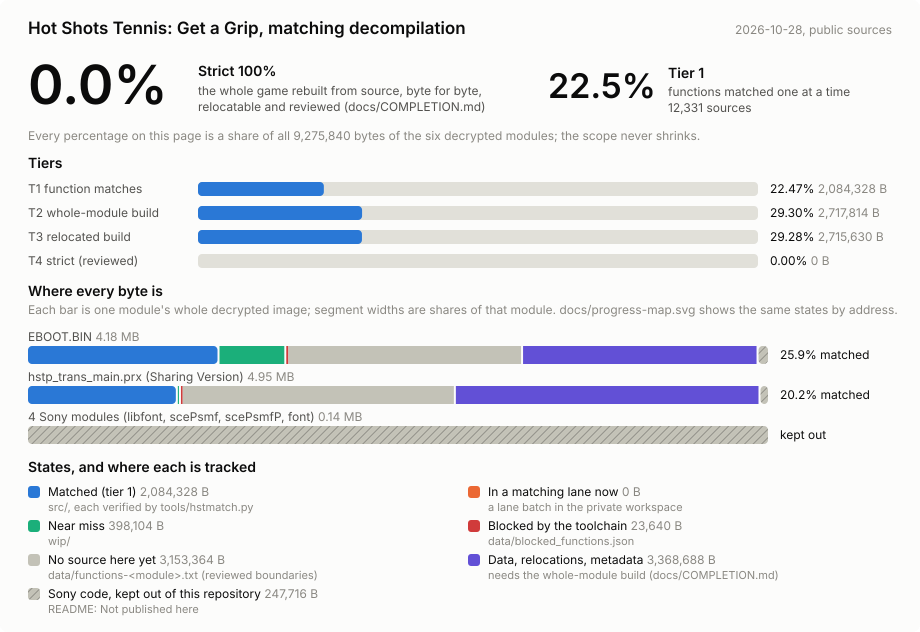
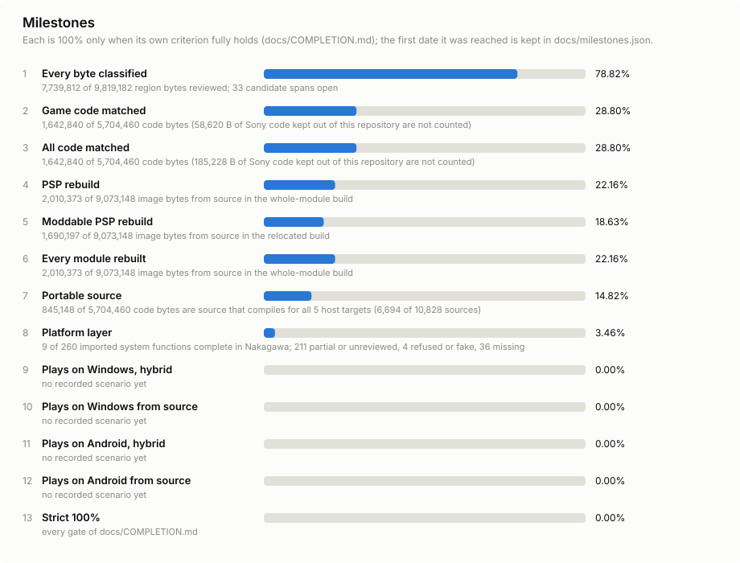
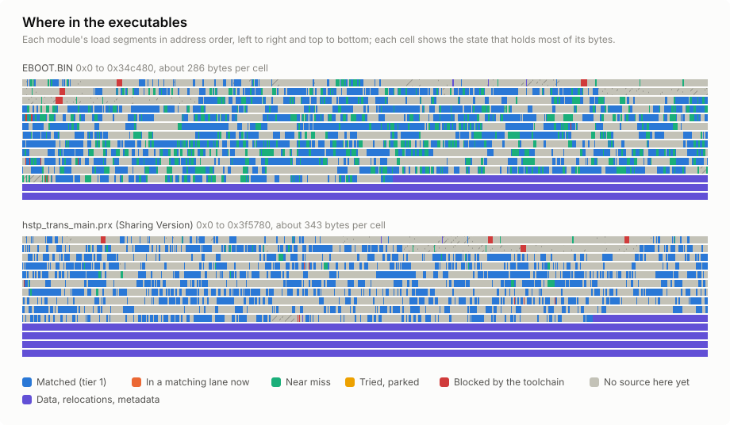
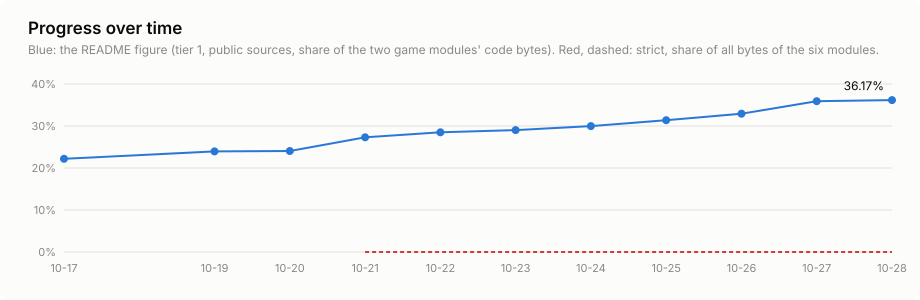

<picture>
  <source media="(prefers-color-scheme: dark)" srcset="docs/images/brand/hst-decomp-mark-dark.svg">
  
</picture>

# Hot Shots Tennis: Get a Grip — matching decompilation

**C and C++ that compiles back to the exact bytes of the PSP game, one function at a time.**

A Nakagawa project, alongside [Nakagawa Recomp](https://github.com/Jstar269/nakagawa-recomp), the PSP-to-native recompiler and player.

## What this is

A work-in-progress decompilation of *Hot Shots Tennis: Get a Grip* (PlayStation Portable, UCUS98701). "Matching"
is strict here: every file in `src/`, compiled with the original compiler (Metrowerks for the game code) and linked at the function's
retail address, reproduces **that function's retail bytes exactly**, with nothing masked. A source that does not match
does not go in `src/`.

## Progress

**10,924 exact sources** (10,925 functions) and 335 near misses, measured 2026-10-22 with `python tools/hstcov.py`
and counted in code bytes:

| Module | Matched / functions | Matched / code bytes | Share of bytes |
|---|---|---|---|
| `EBOOT.BIN` | 5,484 / 9,804 | 807,080 / 2,849,076 | 28.328 % |
| `hstp_trans_main.prx` (Sharing Version) | 5,441 / 9,830 | 774,576 / 2,914,004 | 26.581 % |
| **Both** | 10,925 / 19,634 | 1,581,656 / 5,763,080 | 27.445 % |

Every source is re-verified with `python tools/hstmatch.py` before it is published.

These are tier-1 figures: functions that match exactly when each is compiled and linked on its own. The project's
100% is stricter: the whole executables rebuilt byte for byte from source, data included, relocatable and reviewed.
[`docs/COMPLETION.md`](docs/COMPLETION.md) defines it and reports every tier.

`python tools/hstprogress.py --write` refreshes the four images, `docs/milestones.json`, `progress.json` (the badge) and the history in
`docs/progress.csv`.

## Get started

1. Bring your own, legally obtained copy of the game and decrypt its two executables yourself.
2. Install the compilers in WSL and bootstrap the campaign directory: [Setup](docs/GUIDE.md#setup).
3. Check that everything matches: `python tools/hstmatch.py --all`.

To match a new function, read [CONTRIBUTING.md](CONTRIBUTING.md) and the compiler lessons in
[`docs/MWCC-NOTES.md`](docs/MWCC-NOTES.md).

## The game this repository decompiles, running natively through Nakagawa Recomp

[Nakagawa Recomp](https://github.com/Jstar269/nakagawa-recomp) runs the game's own PSP code natively on Windows, and
this presentation capture shows the title in that build. It is the only game imagery in this repository, under
[`docs/media/`](docs/media), and it is not game data.

Hot Shots Tennis: Get a Grip belongs to its publisher. This repository contains no game data: you need your own copy of the game, and nothing here downloads one.

## Legal

No game assets, executables, keys, decryption code or compilers are in this repository, except the presentation
screenshot in [`docs/media/`](docs/media) described above, and nothing in it lets you obtain the game. The compilers come from [decomp.me's kits](https://github.com/decompme/compilers) and
[wibo](https://github.com/decompals/wibo) under their vendors' licences ([THIRD_PARTY.md](THIRD_PARTY.md)). This is an
unofficial fan project, not affiliated with or endorsed by the game's developer or publisher; the game and its
trademarks belong to their owners.

## License

Licensed by path ([REUSE](https://reuse.software/)): the reconstructed code (`src/`, `wip/`, `symbols/`) is
**GPL-3.0-or-later**, the tools and docs are **MIT**, and newlib-derived code keeps its own notices. The GPL covers
only the project's own work, not the original game. Sony SDK reconstructions are not published here. Full table:
[Licensing](docs/GUIDE.md#licensing).

OpenSSF Scorecard ([`.github/workflows/scorecards.yml`](.github/workflows/scorecards.yml)) runs weekly and on
pushes to `main`, uploading its results to GitHub code scanning; it publishes no badge and changes no settings.

## Learn more

[Project guide](docs/GUIDE.md) · [Contributing](CONTRIBUTING.md) · [Compiler notes](docs/MWCC-NOTES.md) ·
[Security](SECURITY.md) · [Code of conduct](CODE_OF_CONDUCT.md)
